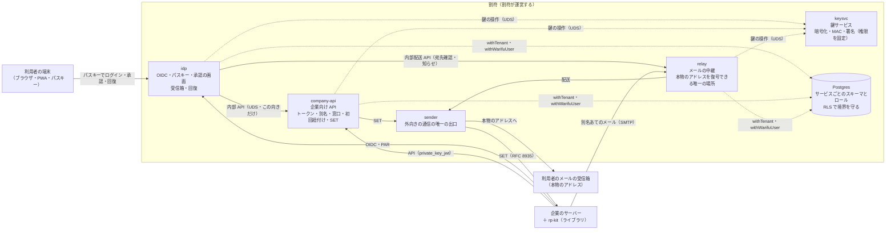

# 割符の構成

割符は、割符が運営するサービスです。企業が自社のシステムに組み込むライブラリは rp-kit だけで、ほかのサービスは割符の側で動きます。この文書は全体の見取り図で、正は [plan](plan.md)、[CLAUDE.md](../CLAUDE.md) の不変条件、[ADR](adr/) です。PoC の構成で、本番で使うことは想定していません。

実線は呼び出しとデータの流れ、点線は割符の内部の鍵と DB の利用です。外へつなぐのは sender だけで、本物のアドレスを復号できるのは relay だけです。

## それぞれの役割

| 部品 | 役割 | 持たないもの・できないこと |
|---|---|---|
| idp | OIDC の発行者。パスキーでのログイン、step-up、操作ごとの承認、受信箱、回復を受け持つ。承認の画面は、企業の画面とは別のオリジンで出す | 本物のアドレスを復号できない。送るメールは relay の内部配送 API に頼む |
| company-api | 企業向けの API。テナントの JWT、別名の入れ替え、窓口、初回紐付け、企業に送る SET の送信待ちを受け持つ | 暗号化も復号もできない。idp へ書き込む向きの API はない |
| relay | 別名あてのメールを受け、送信元ロックと中継の衛生を確かめてから、本物のアドレスへ渡す | 別名を導けない。配送の判断を、本人確認や操作の許可に使わない |
| sender | 外向きの通信の唯一の出口。SET の送信とメールの配送で、宛先の検査（SSRF への対策）を行う | 鍵サービスの資格情報を持たない |
| keysvc | 鍵を持つ別のプロセス。サービスごとに、使える操作と鍵を固定する（本番では KMS） | 鍵を返す操作はない。復号できるのは relay だけ |
| Postgres | サービスごとにスキーマとログインロールを分け、全テーブルに RLS（ENABLE と FORCE）を付ける | 別名と本物の連絡先を平文で置かない |
| rp-kit | 企業のサーバーに組み込む SDK と適合テストキット（模擬 OP を含む。plan 3-3） | 割符のサーバーの代わりにはならない |
| demo-rp | デモ用の企業（A社のデモ証券と、B社の予約サイト）と窓口担当者の画面 | 企業の参照実装で、割符の一部ではない |

パッケージの置き場所は、[CLAUDE.md](../CLAUDE.md) の「配置」を正とします。

## ライブラリにしない理由

- 本物の連絡先を企業に持たせないために、割符が持つ。ライブラリにすると、企業の中に戻ってしまう。
- パスキーと回復を、企業ごとではなく割符が預かる。1つの企業から漏れた連絡先や属性で、ほかの企業の本人確認を突破されないため。
- 企業ごとに別の ID（`sub`）と別名を、割符が導く。企業をまたいで突き合わせられないため。
- 承認の画面を、企業が文言を変えられない割符の画面で出す。

## 攻撃の的になることへの備え

割符は、多くの企業の利用者を預かるので、最大の標的になる（plan 2章）。

- 本物の連絡先を復号できるのは relay だけ。別名は DB に置かず、その都度導く。
- 外向きの通信は sender だけ。各サービスは外へ直接つながない。
- 鍵の操作の権限を、サービスごとに固定する。
- 逆引きのルートと管理 API を作らず、ルート一覧をテストで固定する（テスト6）。
- P0 では、インターネットに公開するサーバーを立てない。公開する前に、外部のレビューと脆弱性診断を受ける（plan 12章）。
