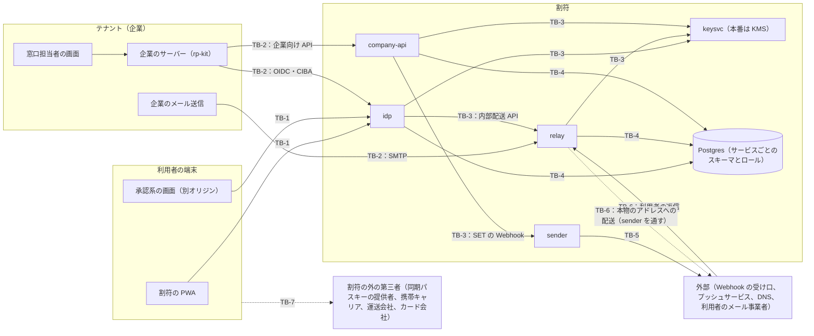

# 03. 脅威モデル

> 状態：M1 時点の骨子（M10 で確定）。正は [docs/plan.md](../plan.md)（Context、1-2、2章、3章、4章、8章、9章、10章、11章）。
> 出典：[CLAUDE.md](../../CLAUDE.md) の不変条件、[ADR 0001](../adr/0001-affirmative-list.md)〜[ADR 0005](../adr/0005-alias-derivation.md)、[ADR 0006](../adr/0006-ciba-spike-findings.md)、[ADR 0010](../adr/0010-staged-participation.md)、[ADR 0013](../adr/0013-local-key-service.md)〜[ADR 0017](../adr/0017-log-allowlist.md)、[DESIGN.md](../../DESIGN.md)、[docs/standards.md](../standards.md)。
> この脅威モデルは、外部のレビュー（登録セキスペ。イシュー #18）にかける（plan 12章）。

## 0. 前提

- 漏えいは防ぎきれない前提で設計する（plan Context）。攻撃者は、どこかで漏れた連絡先や属性を持っているものとする。
- 背景：2026年9〜10月には、国内で大規模な個人情報の漏えいの公表が相次いだ（各社の公表による。個別の原因は事案ごとに異なる）。NICT は2026-10-13に、公開アプリを解析して接続先のサーバーを狙う攻撃を「A2B攻撃」（App-to-Backend）と名付けて注意を促し、相次ぐ漏えいの原因の一つとした。総務省も同日に注意喚起した。この文書は、個別の事案を A2B攻撃に結び付けない。資料の確認状況は standards.md を正とする（NICT の報道発表と総務省の10-13の資料は 2026-10-22 に、NICT の CYNEX の資料は 2026-10-23 に、原文で確認済み）。
- 2026年10月には、JPCERT/CC と国家サイバー統括室も、相次ぐ不正アクセスについて注意喚起や対策をまとめた（standards.md。2026-10-22に原文で確認済み）。この文書は、これらの資料を背景として引くだけで、個別の事案に結び付けない。
- 割符は最大の標的になる（plan 2章）。全テナントの利用者の本物の連絡先（暗号化したもの）が、割符に集まる。
- 効果を述べるときは、[01 の 3章](01-principles.md#3-主張できる範囲)の範囲にとどめる。接続要件を守らない企業と、割符の外の第三者には、この脅威モデルの対策は及ばない。移行中の参加の企業も、「接続要件を守る企業」に含めない（RR-14。[02 の 14章](02-rp-requirements.md#14-移行中の参加)）。
- 表の「不変条件」は CLAUDE.md の番号、「テスト」は plan 11章の番号を指す。PRN・RR は [01](01-principles.md)、RP は [02](02-rp-requirements.md)、CAP は [04](04-capabilities.md) の要件を指す。

### 0-1. 信頼するもの（確かめずに正しいと置く前提）

この脅威モデルの対策は、次のものが正しく動くことを前提にする。割符は、ここに挙げたものの正しさを証明していない。確かめているのは、lint・CI の検査と `test/leak/` のテストに書いたシナリオだけである。これらのどれかが壊れると、その上に立つ対策も効かなくなる。

| 信頼するもの | 頼っていること | 割符の側で確かめていること |
|---|---|---|
| Node.js 22 と、`node:crypto` の下の OpenSSL | AES-256-GCM、HMAC-SHA-256、ES256 などの実装の正しさ。乱数 | 呼ぶ方式とパラメータを許可リストに固定する（不変条件9、テスト8） |
| `oidc-provider`、`@simplewebauthn/server`、Fastify | OIDC のプロトコルの処理、WebAuthn の署名とフラグの検証、HTTP の解析 | 頼っている内部の振る舞いを ADR 0006・0007・0018 に書き、テストで固定する。公開鍵の種類と鍵長は自分で確かめる（ADR 0018）。更新のときは点検する（plan 9章） |
| `mailauth`、`smtp-server`（relay） | DKIM の署名の検証と正規化、DMARC の評価、SMTP の会話の解析と、トランザクションごとの封筒のリセット | 受け付ける署名（方式と鍵長、d=・s=・l=・h=・t=・x=、ヘッダーの数、From の整合）を ADR 0021 の条件で絞る。送信元ロックは、登録した公開鍵だけを返すリゾルバで検証する。DNS は注入したリゾルバだけで引く（不変条件7）。DMARC の組織ドメインの決め方は、ADR 0012 の決定11で確かめた。1トランザクション1宛先と、RCPT の応答が宛先の状態によらないことを、テストで固定する（`t05-relay-*`、`t10-relay-rcpt`）。更新のときは点検する（plan 9章） |
| PostgreSQL 16 と `pg` | RLS、ロールと列単位の GRANT、トランザクションと行のロックの意味 | 全テーブルの RLS の ENABLE と FORCE、ポリシーと GRANT の一覧、SECURITY DEFINER が1つだけであることを固定テストで確かめる（`x-rls-fixed`、`x-db-boundary`） |
| 鍵サービス（ローカル）と KMS（本番） | 操作の ACL の判定、鍵を外に出さないこと | ローカルの鍵サービスは ACL と暗号文の結び付きをテストで確かめる（t08）。本番の KMS は信頼する（P1） |
| 利用者の認証器と、同期パスキーの提供者 | UV の判定、秘密鍵を外に出さないこと、提供者側のアカウント回復の強さ | 確かめられない。同期パスキーの提供者側の回復は RR-02 |
| 利用者のメール事業者と、そのドメインの DNS | 返信の DKIM の署名と、DMARC・SPF のレコードの正しさ | 確かめられない。DMARC が整合して pass した返信だけを中継するが、返信は本人の承認ではないので、企業に根拠にさせない（RP-45、ADR 0021） |
| 実行環境（OS、コンテナ、ネットワーク、時計） | プロセスとソケットの分離、時刻の正しさ | ローカルは Unix ドメインソケットとサービスごとの資格情報（ADR 0013）。本番の設定は P1 |
| 割符の運用者 | マイグレーションとハーネスの例外のロール、鍵と資格情報の管理（CAP-06）、依存の更新の点検 | 手順を ADR と plan に書く。本番の運用の手順は P1 で決める |
| 接続する企業 | 接続要件を守ること | 守らない企業には対策が及ばない（上の前提）。適合テストキットと監査で確かめる範囲は 02 による |

## 1. 守る資産

| ID | 資産 | 置き場所 | 守り方の要点 | 不変条件 |
|---|---|---|---|---|
| AS-01 | 本物の連絡先（P0 はメールだけ。電話番号は集めない） | DB（暗号化）。平文になるのは relay のメモリの中（配送のとき）と、idp のメモリの中（入力のとき）だけ | AES-256-GCM で保存する。decrypt は relay だけ | 3、4、11 |
| AS-02 | 別名 | DB に置かない。`derive_alias` でその都度導く | 導出鍵を外に出さない。URL に載せない。再利用しない | 4、5 |
| AS-03 | 利用者とテナントの対応（誰がどの企業を使っているか） | DB（発行済みの sub、別名の世代） | sub と別名をテナントごとに独立させる。逆引きのルートを作らない | 2、5 |
| AS-04 | 認証と回復の手段（パスキー、回復コード、協力関係） | DB（回復コードは平文で置かない。協力関係は内部 ID の組だけ）と、利用者の端末 | 肯定リストの (b) だけを根拠にする。変更には step-up と全端末への通知 | 1、4 |
| AS-05 | トークンと使い捨ての値（認可コード、アクセス・リフレッシュ・ID の各トークン、auth_req_id、SET、client assertion、窓口コード、招待コード） | 発行先。割符の保存先には HMAC だけ | 平文を残さない。短命にし、一度で失効させる | 4 |
| AS-06 | 協力者の表示名 | 協力者の端末の中だけ | サーバーに置かない | 4 |
| AS-07 | 鍵（保存用の鍵、照合用の HMAC 鍵、別名の導出鍵、sub の導出に使う鍵、署名鍵、DKIM 鍵） | 鍵サービス（ローカル）か KMS（本番）。ES256 の署名鍵は鍵サービス（ADR 0014）。DKIM 鍵も鍵サービス（ADR 0021。[04 の 2章](04-capabilities.md#2-鍵の操作)） | 鍵を外に出さない。サービスごとの資格情報と、操作ごとの ACL | 3、9 |
| AS-08 | 高リスクの操作の権限（配送先・返金先・支払い手段の変更、解約、高額の取引、住所の法定開示への同意） | 企業の側 | 操作に結び付いた step-up だけを根拠にする | 1 |
| AS-09 | 監査ログの完全性 | DB（範囲の情報を持たない全体のチェーンと、範囲を RLS で限った本文。ADR 0016） | 鍵サービスの HMAC でチェーンにし、検証できるようにする。追記だけ | — |
| AS-10 | テナントの資格情報（private_key_jwt の秘密鍵、テナントの JWT、DKIM 鍵） | 企業の側（企業が管理するサーバーの中だけ。RP-75） | 公開アプリに含めない（RP-75）。侵害されたときの封じ込め（plan 2章） | 7、9 |

## 2. 攻撃者のモデル

| ID | 攻撃者 | 持っているもの・できること | 主な狙い |
|---|---|---|---|
| ATK-01 | 漏えいした連絡先や属性を持つ攻撃者 | メール、電話、住所、氏名、生年月日、注文や予約の番号、決済情報、別名、sub など。複数の漏えいを組み合わせることもある | 企業や割符で本人を名乗る。アカウントを奪う。フィッシングや詐欺の宛先にする |
| ATK-02 | A2B攻撃者（公開アプリを解析して、バックエンドの API を狙う） | 公開アプリと PWA の中身、API の一覧、自分の正規のアカウント。アプリに含まれていれば、API のエンドポイントとキーや資格情報。既知の脆弱性のスキャンや API 経由の攻撃に AI を使うこともある | BOLA（ほかの利用者やテナントのものに触れる）、SSRF、SQL インジェクション。管理用・内部の API。逆引きと、連絡先の列挙 |
| ATK-03 | 悪意のある・侵害されたテナント | 自分のテナントの資格情報と DKIM 鍵、自分の利用者の sub と別名。company-api、CIBA、別名あての送信を使える。テナントが入れる文字列（client_name、ロゴ、binding_message、Webhook の URL）を決められる | 企業をまたいだ突き合わせ。利用者をだます承認画面。SSRF。別名あてのフィッシング |
| ATK-04 | 窓口でのソーシャルエンジニアリングとリアルタイム中継 | 企業を名乗って利用者に電話する。利用者を名乗って企業の窓口に連絡する。ATK-01 の情報も使う | 窓口コードと承認を引き出す。窓口で変更をさせる |
| ATK-05 | SIM スワップと、同期パスキーの提供者側の回復 | 携帯キャリアでの SIM の再発行。Apple や Google の、SMS などによるアカウント回復 | 同期アカウントを奪い、同期パスキーを手に入れる |
| ATK-06 | 内部の運用者・管理者 | DB、ログ、バックアップ、運用の手順に近づける | 連絡先や対応関係を見る。設定を書き換える |
| ATK-07 | 割符のサービス単位の侵害 | idp、relay、company-api、sender、keysvc のどれか1つのプロセスと資格情報 | そのサービスの能力を超えた操作。ほかのサービスへの横の移動 |
| ATK-08 | 利用者の身近な人 | 回復コードを手に取れる。協力者になっていることがある。端末のロック画面を見られる | 利用者の割符のアカウントを回復して奪う |
| ATK-09 | 供給網を通じた侵害 | 割符が使う依存パッケージや CI のアクションの更新。外注先の開発環境と資格情報 | 割符のコードに不正な処理を入れる。鍵や資格情報を得る |

- ATK-08 は、ADR 0003 の残るリスク（RR-07）から足した。
- ATK-02 の持ち物（アプリの解析で特定した API のエンドポイントやキー、AI を使ったスキャンと攻撃）は、JPCERT/CC と JPCERT/CC Eyes の資料（2026-10。standards.md。原文で確認済み）を背景に足した。資格情報への広げ方は、この脅威モデルの判断である。
- ATK-09 は、国家サイバー統括室の資料（サプライチェーンを通じた侵害への対策。2026-10-09。standards.md。原文で確認済み）を背景に足した。

## 3. 信頼境界

| ID | 境界 | またぐもの | 守り方 | 不変条件 |
|---|---|---|---|---|
| TB-1 | 利用者の端末 ↔ idp | パスキーのアサーション、PWA の操作、承認と拒否 | UV 付きのパスキー。所有者の照合。厳格な CSP（nonce）と Trusted Types。承認系の画面は別オリジン | 1、2、10 |
| TB-2 | テナント ↔ 割符（idp、company-api、relay） | OIDC と CIBA の要求、企業向け API、別名あてのメール、テナントが入れる文字列 | private_key_jwt（ES256）。テナントに結び付いた JWT。hint は窓口コードだけ。binding_message は割符が生成する。テナント由来の文字列はテキストとしてだけ描画する。送信元ロック | 1、5、6、7、9 |
| TB-3 | 割符のサービスどうし（keysvc、relay の内部配送 API、sender） | 鍵の操作、配送の依頼 | 外から届かないようにする（CAP-38）。サービスごとの資格情報と、操作ごとの ACL（[04](04-capabilities.md)）。decrypt は relay だけ | 3、7 |
| TB-4 | 割符のサービス ↔ DB | 読み書き | `withTenant` と `withWarifuUser`。RLS の ENABLE と FORCE。サービスごとのロールと、列単位の GRANT | 8 |
| TB-5 | 割符 → 外部 | HTTP(S)、SMTP、名前解決 | 出口は sender だけ。公開のユニキャストでない IP の拒否と、確かめた IP への直接の接続。リダイレクトに従わない（ADR 0022） | 7 |
| TB-6 | 外部のメール ↔ relay | 企業からの別名あてのメール、利用者からの返信、本物のアドレスへの配送 | 送信元ロック、中継の衛生、DMARC の整合、RCPT への応答を一律にする。本物のアドレスへの配送は sender の内部 API を通す（実配送は、受け取ったメールの永続化と再試行の後。ADR 0021、ADR 0022） | 1、4、7、10 |
| TB-7 | 利用者 ↔ 割符の外の第三者 | 同期アカウントの回復、SIM の再発行、荷物の受け取り、3DS | 割符からは変えられない（RR-02、RR-03） | — |

- ローカルでは、各サービスを localhost のポート違いで動かす。クッキーはポートをまたいで共有されるので、クッキーの分離を前提にした検証は、ローカルでは成り立たない（CLAUDE.md「環境の注意」）。

## 4. 脅威と対策

### 4-1. 漏れた連絡先や属性による突破

| ID | 脅威（攻撃者） | 経路 | 対策 | 不変条件 | テスト |
|---|---|---|---|---|---|
| TH-01 | 窓口で本人を名乗る（ATK-01） | 企業の窓口（電話・チャット・店頭）で、氏名、予約番号、別名、sub などを言う | 窓口の本人確認は CIBA だけ（RP-20）。担当者の画面に、連絡先や予約番号での検索を置かない（RP-27）。失敗したら、一般的な案内と一時停止だけ（RP-60） | 1、6 | 1 |
| TH-02 | 企業の旧ログインや再設定で、アカウントを奪う（ATK-01） | 漏れたメールで、パスワードの再設定、メールのリンク、SMS を使う | ログインは割符の OIDC だけ（RP-04）。紐付けの完了で旧経路を廃止する。参加の時点で、未紐付けの会員の再設定も止める（RP-31、RP-32） | 1 | 9 |
| TH-03 | 紐付けの攻撃（ATK-01） | 漏れたメールで旧アカウントを奪い、攻撃者自身の sub を紐付ける | RP-30〜33。適合テストで不合格にする | 1 | 9 |
| TH-04 | email クレームによる自動の統合（nOAuth 型）（ATK-01、ATK-03） | 同じ email を持つ別人として ID トークンを得て、既存のアカウントに統合させる | email クレームは別名だけにし、`email_verified` は常に false。識別は `(iss, sub)` だけ（RP-01、RP-05） | 1、5 | 4、9 |
| TH-05 | ゲスト照会（ATK-01） | 予約番号、電話、メール、氏名の組み合わせで、照会・変更・取り消しをする | ゲスト照会の画面と API を持たない（RP-40） | 1 | 9（適合テストキットの「ゲスト照会」。02 の 15-1） |
| TH-06 | 属性による本人確認（ATK-01） | 住所と生年月日などで照合させる | 接続要件で禁じ、CIBA か step-up を使わせる（RP-07） | 1 | 未割り当て（監査） |
| TH-07 | 電話番号による本人確認（ATK-01、ATK-05） | 企業が持ち続けている電話番号への SMS や着信 | 肯定リストで根拠にさせない（PRN-40、RP-03）。割符は電話番号を集めない（PRN-83）。電話の中継は保留（ADR 0004） | 1、11 | 未割り当て（監査） |
| TH-08 | 漏れた連絡先で、割符の回復を始める・アカウントを探す（ATK-01） | 回復と登録の画面 | 回復は回復コードだけで始める。連絡先の入力欄を置かない（PRN-85）。回復コードだけでは成立しない（PRN-21） | 1、10 | 3、10 |
| TH-09 | 移行中の企業に残っている入り口から突破する（ATK-01、ATK-03） | 移行中の参加の企業で、入り口の一覧（ENT-01〜03）に残っている経路（メールや SMS での再設定、企業独自のパスワードでのログイン、予約番号などでの照会、変更、取り消し）を、漏れた連絡先や属性で使う。ENT-02 では、漏れたパスワードを使う。ENT-01 が残る間に、未紐付けの会員の旧アカウントを奪い、攻撃者の sub を紐付ける。ENT-03 などで再設定の宛先を書き換えてから、ENT-01 で再設定する。企業が、閉じていない入り口を閉じたと申告する。割符が確かめるときだけ、または試験用のアカウントにだけ、入り口を閉じて見せる | 主張の対象から外す（01 の 3章）。残してよいのは入り口の一覧の経路だけで、期限を付ける（RP-15、RP-16）。高リスクの操作（RP-10、RP-13）と、RP-05、RP-07、RP-27 は緩めない。ENT-01 の再設定の宛先の変更も、操作ごとの承認だけにする（RP-18）。ただし、紐付けの攻撃で攻撃者の sub が紐付いたアカウントでは、攻撃者が自分の端末で操作ごとの承認を出せるので、RP-10、RP-13 の守りは働かない。入り口の一覧の各項目を、警告文 I の一覧1と一覧2に分けて、接続の同意の画面と、別名の一覧の企業ごとの詳細に出す。既定は一覧2で、割符が自ら確かめたときだけ一覧1に移し、企業の自己申告や適合テストキットの結果では移さない。確かめ直しの間隔を過ぎたら一覧2に戻す。割符の確かめは、確かめた時点の、試験用のアカウントについての結果で、企業が利用者の一部にだけ入り口を残すことは見抜けない。接続の契約（RP-17）と監査（RP-15）で補う。参加の状態と確かめた項目は、企業向けのルートから書き換えられない（04 の 3章）。RR-14 として残る | 1 | 6（企業向けのルートから参加の状態を書き換えられないこと。M5）、9（表示の場所、自己申告やキットの結果で移らないこと、間隔を過ぎたら戻ること、緩めていない検査の不合格。M9） |

- TH-02、TH-03、TH-05、TH-07 の対策は、完全な参加の企業についてのもの。移行中の参加の企業では、入り口の一覧の経路が期限まで残る。ENT-01 の SMS による再設定は、TH-07 の経路に当たる（TH-09、RR-14）。TH-06 の対策（RP-07）は、移行中でも緩めない。

### 4-2. 窓口と承認

| ID | 脅威（攻撃者） | 経路 | 対策 | 不変条件 | テスト |
|---|---|---|---|---|---|
| TH-10 | 窓口でのリアルタイム中継（ATK-04） | 企業を名乗って利用者に電話し、窓口コードと承認を引き出す | 窓口コードの2段階の発行（アプリから公式窓口へ連絡する。相手に求められて発行しようとしていないかを、DESIGN.md 2章の問いで確かめる。UV 付きパスキーで発行する）。警告文 A-1・B。企業から始めた連絡（通話、メール、SMS、チャットなど）でコードを求めることを禁じる（RP-24）。CIBA の結果は照会と軽い手続きだけ（RP-21）。高リスクの操作は端末での step-up だけ（RP-10）。窓口での変更は全端末に事後通知し、24時間は取り消せる（RP-28、警告文 E） | 1、6 | 1 |
| TH-11 | 窓口コード以外の hint で、利用者を指定する（ATK-03、ATK-01） | CIBA の `login_hint` にメールや電話を入れる。`id_token_hint`、`user_code` を使う | 入口で拒否する（RP-22）。discovery でも user_code を使わないと示す（ADR 0006） | 6 | 2 |
| TH-12 | 窓口コードの総当たりと流用（ATK-03、ATK-01） | 別のテナントで使う、使い回す、期限の後に使う、総当たりする | client_id に結び付け、数分で失効させ、一度で失効させる。失敗の応答は、理由を問わず同じにする（ADR 0006）。桁数は、テナントごとの試行上限から決める（M7 で ADR に記録する） | 1、6 | 2、6（レート制限） |
| TH-13 | 承認画面で利用者をだます（ATK-03） | 企業が送った binding_message、client_name、ロゴ、`authorization_details` の自由な項目 | binding_message は割符が生成する（RP-23）。テナント由来の文字列は、補足として、テキストとしてだけ描画する。ロゴは登録時に取り込んだものだけ。型に合わない `authorization_details` は、承認画面を出さずに拒否する（RP-11）。DESIGN.md 1章・2章 | 6 | 2（binding_message）。ほかは未割り当て |
| TH-14 | step-up の承認の流用とすり替え（ATK-03、ATK-04） | ある操作の承認を、別の操作や内容の違う操作に使う。電話で頼んで承認させる | 操作ごとの短命な承認（RAR）と、オリジンに結び付いたパスキー（RP-10〜12）。承認画面に操作の種類と内容を出す。警告文 A-2 | 1、9 | 1（step-up がなければ拒否）。流用の検査は未割り当て |
| TH-15 | ブラウザ側の攻撃（XSS など）で、承認を操作する（ATK-02、ATK-03） | PWA と承認画面にスクリプトを入れる。配信物を解析して、資格情報や画面の中の検査を探す | 厳格な CSP（nonce）と Trusted Types。テナント由来の文字列はテキストとしてだけ描画する。承認系の画面は別オリジン（plan 2章、CAP-36）。配信物に資格情報を含めず、認証と認可の判断はサーバーで行う（CAP-37） | — | 未割り当て |

### 4-3. 回復と認証器

| ID | 脅威（攻撃者） | 経路 | 対策 | 不変条件 | テスト |
|---|---|---|---|---|---|
| TH-20 | 盗んだ回復コードで回復する（ATK-01、ATK-08） | 偽の回復ページなどで、回復コードを得る | コードだけでは成立しない。協力者の承認と、待機期間の満了が要る（PRN-21）。待機中は、登録済みの端末と協力者に知らせ、取り消せる（PRN-88、警告文 F）。取り消すとコードが失効し、14日間は回復を始められない（PRN-89） | 1 | 3 |
| TH-21 | 協力者をだまして承認させる（ATK-04、ATK-01） | 電話やビデオ通話でコードを伝え、協力者に入力させる | 承認は対面の QR が第一。手入力は QR が使えない場合だけ。警告文 C。「入力しない」を承認と同じ大きさにする（PRN-87、DESIGN.md 2章） | 1 | 未割り当て |
| TH-22 | 協力者の指名の悪用（ATK-01、ATK-08） | 連絡先で他人を探して協力者にする。招待コードを電話で受け取る | 指名は、対面の QR か使い捨ての招待コードだけ。連絡先での検索を作らない。step-up で確定し、全端末に知らせる。警告文 H（PRN-86） | 1 | 未割り当て |
| TH-23 | 乗っ取られたばかりの協力者に承認させる（ATK-01、ATK-05） | 回復した直後や、パスキーを足した直後の協力者の承認を使う | 直近14日以内に回復した協力者や、パスキーを追加した協力者の承認を無効にする（PRN-87） | 1 | 3（回復した協力者）。パスキーを追加した協力者は未割り当て |
| TH-24 | 回復の直後に、高リスクの操作をする（ATK-01、ATK-05、ATK-08） | 回復したアカウントで、配送先の変更などをする | 回復後7日間の制限と、古いパスキーの一時停止（PRN-90）。企業は `recovered_at` で保留する（RP-53、RP-54） | 1 | 3 |
| TH-25 | SIM スワップから同期パスキーを得る（ATK-05） | SIM の再発行 → 同期アカウントの奪取 → 同期パスキーでログインする | 割符は SMS と電話番号を使わない。端末固定のパスキーを推奨し、BE/BS フラグを記録して変化を信号にする。同期先アカウントの強化を案内する（PRN-84）。RR-02 として残る | 1、11 | 未割り当て |
| TH-26 | 認証器を足して居座る（ATK-01、ATK-05） | 一度だけ得たセッションで、パスキーを追加する | パスキーの追加と削除に step-up を求め、全端末に知らせる（PRN-84。知らせは受信箱。ADR 0023） | 1 | 未割り当て（`x-idp-passkeys`、`x-inbox-notices` で確かめる） |
| TH-27 | 割符に登録したメールを書き換えて、知らせを奪う（ATK-01） | 割符の本物のメールを、攻撃者のアドレスに変える | 変更は step-up と、新しいアドレスの宛先確認だけ。旧アドレスには、リンクを含まない知らせを送る（PRN-81）。知らせの正は端末の受信箱（PRN-92。M6 で、登録と変更を受信箱に知らせる。ADR 0023） | 1、3 | 未割り当て（`x-inbox-notices` で確かめる） |
| TH-28 | ロック画面やプッシュ通知から読み取る（ATK-08） | ロック画面に出た通知を見る | 一般的な文言だけを出す（PRN-92、DESIGN.md 1章） | — | 未割り当て |

### 4-4. A2B と、割符への直接の攻撃

| ID | 脅威（攻撃者） | 経路 | 対策 | 不変条件 | テスト |
|---|---|---|---|---|---|
| TH-30 | BOLA：テナントをまたぐ（ATK-02、ATK-03） | A社のトークンで、B社の利用者や別名に触れる | テナントに結び付いた JWT（RP-73）。`withTenant`、RLS の ENABLE と FORCE（CAP-10〜13） | 8 | 6 |
| TH-31 | BOLA：利用者をまたぐ（ATK-02） | U1 が、U2 の別名の一覧、協力者、受信箱、CIBA の auth_req_id に触れる | 利用者向けの全ルートで、所有者を照合する（CAP-33）。`withWarifuUser`、RLS | 8 | 6（受信箱と承認待ちは M6 の `x-inbox-bola`。横断の検査は M10） |
| TH-32 | 逆引き（ATK-02、ATK-03、ATK-06） | sub、別名、窓口コードから、本物の連絡先や本人の属性を引く | 逆引きのルートを作らない。ルート一覧を固定する。P0 では管理 API を作らない（CAP-30〜32）。SECURITY DEFINER 関数は2つの ID だけを返す（CAP-14） | 2、8 | 6 |
| TH-33 | 連絡先の列挙（ATK-02、ATK-01） | 登録、回復、宛先確認、SMTP の RCPT への応答の違い（本文、ステータス、所要時間） | 登録済みかどうかで応答を変えない（PRN-82）。生きている別名、廃番、存在しない別名で、RCPT への応答を同じにする | 10 | 10 |
| TH-34 | SSRF（ATK-02、ATK-03） | `jwks_uri`、`sector_identifier_uri`、`request_uri`、Webhook の URL、MX、プッシュの宛先を使い、IMDS、内部 API、プライベート IP に接続させる。DNS rebinding、リダイレクト | 外向きの通信は sender だけ。https に限る。名前解決した IP がプライベートなら拒否し、その IP に直接つなぐ。MX にも同じ制限。リダイレクトに従わない。サイズと時間の上限。sender は KMS の権限を持たず、IMDS と VPC 内に届かない。oidc-provider の設定と、動的クライアント登録の無効化（CAP-20〜26）。Webhook は 443 だけで、答えに1つでも公開でないアドレスがあれば名前ごと断る。company-api は jose の createRemoteJWKSet を使わない（lint。ADR 0022） | 7 | 11（`t11-sender-ssrf`、`x-relay-sender`。横断の検査は M10） |
| TH-35 | SQL インジェクションや DB の窃取（ATK-02、ATK-06） | DB の中身を読み出す。BI ツールなど、DB につながる別の入口からの SQL インジェクション。バックアップや DB の複製、設定ファイルの窃取 | DB に、平文の連絡先、別名、トークンを置かない（CAP-16）。復号できるのは relay の資格情報だけ。RLS と、サービスごとのロール。BI ツールや分析基盤をつながない（CAP-18）。サービスの資格情報を平文で置かない（CAP-06）。クエリは `sql` タグでだけ組み立て、値はパラメータにする（ADR 0015） | 3、4、8 | 7、8 |
| TH-36 | ログや配送ログからの漏えい（ATK-02、ATK-06） | ログ、エラー報告、配送ログ、URL のクエリ | 構造化したログと、warifu-core の1か所での伏せ字。配送ログに件名と本文を残さず、Message-ID は HMAC にし、期限で消す。別名を URL に載せない（CAP-41〜43） | 4 | 7 |
| TH-37 | 総当たり（ATK-02、ATK-01） | ログイン、回復の開始、窓口コードの発行と照合、CIBA の要求と poll、宛先確認の送信、協力者への依頼、企業向け API を繰り返す | 機能ごとのレート制限。キーは「アカウント」「送信元（IP、端末、テナント）」「その組み合わせ」。値は M3、M5（ADR 0022）、M7、M8 で ADR に記録する（CAP-34）。SMTP の受信は、1通 10 MiB、同時接続 100、1トランザクション1宛先（送信元ごとの上限は P1。ADR 0021） | — | 6 |
| TH-38 | 暗号の誤用（ATK-02、ATK-03） | alg の取り違え。HS256、alg なし、RS256 の client assertion。許可していない WebAuthn のアルゴリズム。rsa-sha1 の DKIM | 用途ごとの許可リスト（[04 の 6章](04-capabilities.md#6-暗号の許可リスト)）。client assertion の aud は issuer だけにする（ADR 0006） | 9 | 8 |
| TH-39 | 内部の API への到達（ATK-02、ATK-07） | 外から、または侵害したサービスから、keysvc、relay の内部配送 API、sender を呼ぶ | 外から届かないようにする（CAP-38。鍵サービス、relay の内部配送 API、sender は Unix ドメインソケットだけで待ち受ける。ADR 0013、0021、0022）。サービスごとの資格情報と、操作ごとの ACL（CAP-01）。sender の口は呼び出し元ごとに分ける。内部の接続の組を限る（CAP-27） | 3、7 | 8（鍵サービスの 403 と、t08-keysvc-isolation）。relay の内部配送 API は `x-relay-internal-api`、sender は `x-sender-internal-api`（どちらも番号なし） |

### 4-5. テナントと、企業をまたいだ突き合わせ

| ID | 脅威（攻撃者） | 経路 | 対策 | 不変条件 | テスト |
|---|---|---|---|---|---|
| TH-40 | 企業をまたいだ突き合わせ（複数の ATK-03） | sub、別名、SET の jti と送信時刻、relay の送信元のサブドメインを持ち寄る | テナントごとに独立した値にする。sub はテナント ID と HMAC から導く。jti はテナントごとの乱数にし、送信時刻をテナントごとにずらす。relay のサブドメインを企業ごとに分ける。氏名と受け取り場所による突き合わせは防げない（RR-05） | 5 | 4、12 |
| TH-41 | 別名の再利用（ATK-03） | 廃番の別名を別の人に割り当てさせ、メールを届かせる・人を結び付ける | 世代で管理し、照合用の HMAC に一意制約をかけて、二度と割り当てない。旧別名あてのメールは、同じ 250 で受けて届けない（不変条件10）。入れ替えは企業が sub で1件ずつ頼む（ADR 0022） | 5 | 4（`t04-alias-rotation`） |
| TH-42 | 侵害されたテナントからのフィッシング（ATK-03） | 正規の DKIM 鍵で、別名あてにフィッシングを送る | 緊急停止（送信、CIBA、API）。テナントの資格情報と DKIM 鍵を入れ替えた後に、別名を再発行する（RP-74）。固定の警告文で、割符や企業がコードを求めないことを示す。RR-08 として残る | 7、9 | 未割り当て |
| TH-43 | 企業のなりすましメール（外部の攻撃者、ATK-03） | 企業を名乗って別名あてに送る。署名の範囲の外での改ざん。リプレイ | 送信元ロック：`d=` の完全一致、`l=` の拒否、`h=` の必須ヘッダーと oversign、From・To・Subject の重複の拒否、リプレイの判定（RP-80〜84） | 1 | 5 |
| TH-44 | 企業の管理用・内部の API の悪用（ATK-02） | 公開アプリを解析して企業の管理用・内部の API を見つけ、配送先の変更などの高リスクの操作や、アカウントの作成・統合を要求する。番号だけで、ほかの利用者の予約や注文を引く | どの経路でも、高リスクの操作は操作ごとの承認だけを根拠にする（RP-10、RP-13）。sub の書き換えと統合をしない（RP-33）。要求ごとに対象の持ち主を確かめる（RP-08）。割符の対策は、接続要件を守る企業にだけ及ぶ | 1 | 未割り当て（demo-rp の「悪い RP」のモードに入れるかは M9 で決める） |
| TH-45 | 公開アプリから取り出した企業の資格情報（ATK-02） | 企業のアプリを解析し、含まれていた private_key_jwt の秘密鍵やテナントの JWT で、company-api や CIBA を呼ぶ | 資格情報を公開アプリに含めない（RP-75）。判断は企業のサーバーで行う（RP-76）。テナントの JWT は5分で、scope は1つ（別名の入れ替えと検証の SET の依頼）。緊急停止にして配備し直すと、発行済みのものも断る。資格情報の入れ替え（RP-74。ADR 0022） | 7、9 | 6（`x-company-api-tenant`。緊急停止と、トークンの書き換え） |

### 4-6. メール中継

| ID | 脅威（攻撃者） | 経路 | 対策 | 不変条件 | テスト |
|---|---|---|---|---|---|
| TH-50 | 中継の衛生の不備で、本物のアドレスが漏れる（ATK-03） | 開封通知（Disposition-Notification-To、Return-Receipt-To）、List-Unsubscribe の `mailto:`、全員に返信したときの To と Cc、署名の外で足された Reply-To | 開封通知と Cc の削除、To を別名だけにすること、relay 経由のアドレスへの書き換え、署名した Reply-To だけを返信の先にすること（plan 3-2、ADR 0021） | 2、4 | 5 |
| TH-51 | 返信から本物のアドレスが漏れる（ATK-03） | 利用者の返信のヘッダー（DKIM-Signature、Received、X-*、References の Message-ID）や本文 | 残すヘッダーを決めて、ほかを取り除く。References からは本物のアドレスのドメインの Message-ID を消す。件名と本文（符号化、文字コード、HTML の文字参照、全角などを戻したもの）に本物のアドレスがあれば、転送せずに利用者へ差し戻す。中身を確かめられない部分（添付ファイル、画像など）を含む返信も差し戻す。返信用のアドレスは、やり取りごとの使い捨ての乱数（plan 3-2、ADR 0021）。本文の中の、本物のアドレス以外の個人の情報と、利用者が意図して崩して書いたアドレスは残る | 2、4 | 5 |
| TH-52 | 偽の返信を根拠にさせる（ATK-01） | 利用者の From を詐称して返信用のアドレスに送り、企業に変更をさせる | 本物のアドレスのドメインで DMARC が整合して pass した返信だけを中継する。pass しても本人の承認ではない。`X-Warifu-Unauthenticated` を付け、企業は根拠にしない（RP-45） | 1 | 5 |

### 4-7. 内部と、サービス単位の侵害

侵害の影響の範囲は、[04 の能力の表](04-capabilities.md)で決まる。ネットワークでも、内部の接続の組を限る（CAP-27）。

| ID | 脅威（攻撃者） | 経路 | 対策 | 不変条件 | テスト |
|---|---|---|---|---|---|
| TH-60 | 運用者・管理者による参照や変更（ATK-06） | DB、ログ、管理の機能。運用者のアカウントの不正利用 | P0 では管理 API を作らない。連絡先、認証器、協力者、回復の設定を変える機能は、管理 API に作らない（PRN-93）。DB とログに平文を置かない。decrypt は relay の資格情報だけ。監査ログのチェーン。凍結と法令に基づく開示は P1（ADR で手順を決めるまで実装しない）。運用者は、フィッシング耐性のある多要素認証で本番の環境に入る（plan 2章。手順は P1） | 2、3、4 | 6、7、8 |
| TH-61 | idp の侵害（ATK-07） | idp の資格情報で、鍵の操作をする | idp は decrypt を持たないので、保存済みの連絡先は読めない。署名の鍵は鍵サービスにあり、idp は持たない（ADR 0014。侵害の間は署名を頼める）。ただし、侵害の間に入力された連絡先と、発行するトークンは、メモリの中で見える。P0 では、oidc-provider の保存物とセッションもメモリに置く（id は HMAC。ADR 0018） | 3 | 8 |
| TH-62 | relay の侵害（ATK-07） | relay の decrypt で、連絡先を復号する | decrypt を持つのは relay だけ。テナントを横断する DB の操作は、SECURITY DEFINER 関数1つだけ（CAP-14） | 3、8 | 8 |
| TH-63 | company-api の侵害（ATK-07） | `derive_alias` で、別名を導く | decrypt を持たない。テナントの境界（`withTenant`） | 3、8 | 8 |
| TH-64 | sender の侵害（ATK-07） | 送る内容を見る。任意の宛先へ送る | 鍵の操作を持たない。KMS の権限を持たず、IMDS と VPC 内に届かない。DB を使わない。宛先と内容をログに残さない（ADR 0022） | 3、7 | 8、11 |
| TH-65 | 鍵の漏えい（ATK-06、ATK-07） | 鍵サービスの鍵を持ち出す。別名の導出鍵から、全員の別名を計算する | 鍵を外に出さない（本番は KMS）。鍵の失効と入れ替えの手順を持つ（CAP-07）。導出鍵の入れ替えの手順は P1（ADR 0005）。RR-11 として残る | 3、9 | 未割り当て |
| TH-66 | 依存や外注先を通じた侵害（ATK-09） | 依存の更新に不正なコードを混ぜる。外注先の資格情報で、リポジトリや環境に入る | 版の完全な固定と package-lock.json、インストールスクリプトを動かさないこと（`.npmrc` の `ignore-scripts=true` と `npm ci --ignore-scripts`）、アクションの SHA 固定（plan 9章「依存の更新」）。main のルールセット（PR を必須にし、CI の成功を必須にし、force push と削除を禁じる。plan 12章）。書き込みの権限を持つ人がメンテナーのほかに増えたら、CODEOWNERS によるメンテナーのレビューも必須にする。PWA は外部のフォントや CDN を使わない（DESIGN.md 5章）。外注先にも不変条件を適用する。外注先の権限と管理は未定（P1。plan 10章） | — | 未割り当て |
| TH-67 | 暗号文の入れ替え（ATK-02、ATK-06） | DB を書き換えられる者が、利用者 U1 の暗号化した連絡先を U2 の行に移し、relay に U1 のアドレスへ配送させる。暗号文を書き換える | 暗号文を文脈（利用者 ID など）に結び付け、文脈が違えば復号できないようにする。タグは16バイトだけを受け付ける（ADR 0013） | 3、4 | 8 |

### 4-8. 割符の外

| ID | 脅威（攻撃者） | 経路 | 対策 | 不変条件 | テスト |
|---|---|---|---|---|---|
| TH-70 | 割符の外の第三者での本人確認の突破（ATK-01、ATK-05） | 運送会社の受け取りの認証、カード会社の 3DS の SMS、携帯キャリアでの SIM の再発行 | 割符からは変えられない。運送会社との交渉（イシュー #16）。カード会社の側のパスキーを推奨する（RP-91、イシュー #17）。RR-03 として残る | — | テストなし（割符の外） |
| TH-71 | 漏れた連絡先と住所の悪用（ATK-01） | フィッシングや詐欺の宛先にする。住所で物理的な被害を与える | 固定の警告文で、割符や企業がコードを求めないことを示す（DESIGN.md 3章）。住所を段階的に減らす（plan 5章）。RR-08、RR-09 として残る | — | テストなし（割符では防げない） |

### 4-9. テストの割り当てがない脅威

TH-06、TH-07、TH-13（binding_message 以外）、TH-14（流用）、TH-15、TH-21、TH-22、TH-23（パスキーを追加した協力者）、TH-25、TH-26（step-up は M3 の `x-idp-passkeys`、全端末への知らせは M6 の `x-inbox-notices` で確かめる）、TH-27（受信箱への知らせは `x-inbox-notices`）、TH-28、TH-39（鍵サービスの 403 以外）、TH-42、TH-44、TH-65、TH-66 には、plan 11章のテストが割り当てられていない。テストか監査の項目を割り当てるかは、未定（M10 で決める）。

- 新しいルートを足したとき、または認証・回復・承認・窓口・中継の分岐を変えたときは、`test/leak/` にテストを足す。テストには、攻撃者が持っている情報、試す経路、期待する結果（拒否と、そのステータス）と、plan 11章のテスト番号を書く（不変条件12）。

## 5. 残るリスク

[01 の 4章](01-principles.md#4-残るリスク)を正とする。ここでは、どの脅威と攻撃者に当たるかだけを示す。項目は省かない。

| ID | リスク | 関係する脅威 | 攻撃者 |
|---|---|---|---|
| RR-01 | 窓口でのリアルタイム中継 | TH-10 | ATK-04 |
| RR-02 | 同期パスキーの提供者側の回復 | TH-25 | ATK-05 |
| RR-03 | 割符の外の第三者（運送会社、カード会社の 3DS の SMS、携帯キャリアの SIM の再発行） | TH-70 | ATK-01、ATK-05 |
| RR-04 | 電話について原則2は未達 | TH-07 | ATK-01 |
| RR-05 | 企業をまたいだ突き合わせ（氏名と受け取り場所） | TH-40 | ATK-03 |
| RR-06 | 回復の弱点：端末をすべて失うと、待機中の知らせが本人に届かない | TH-20 | ATK-01 |
| RR-07 | 回復の弱点：身近な人が協力者で、回復コードも手に取れる | TH-20、TH-22 | ATK-08 |
| RR-08 | フィッシングや詐欺の宛先にされること | TH-42、TH-71 | ATK-01、ATK-03 |
| RR-09 | 住所による物理的な被害 | TH-71 | ATK-01 |
| RR-10 | 割符自身の漏えい報告義務 | TH-35、TH-36、TH-39、TH-60〜66 | ATK-02、ATK-06、ATK-07、ATK-09 |
| RR-11 | 別名の導出鍵の漏えい（ADR 0005） | TH-65 | ATK-06、ATK-07 |
| RR-12 | 回復コードのフィッシング（ADR 0003） | TH-20、TH-21 | ATK-01、ATK-04 |
| RR-13 | 企業の側の漏えいそのもの | TH-44、TH-45 | ATK-02 |
| RR-14 | 移行中の企業に残っている入り口 | TH-02、TH-03、TH-05、TH-07、TH-09 | ATK-01、ATK-03 |
| RR-15 | 利用者が自分から企業に伝えた連絡先や属性 | TH-09、TH-44、TH-45、TH-51 | ATK-01、ATK-02、ATK-03 |
